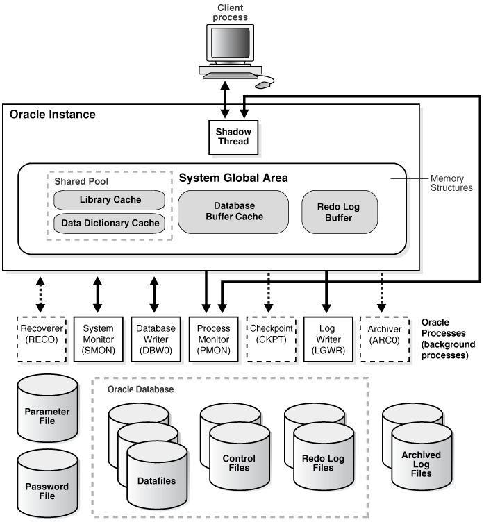

## 🗄️Oracle DBA Essentials: Instances, Objects, Startup, and Shutdown

Imagine a production server just rebooted after an emergency, and your database is stuck halfway through startup and refusing user connections.

If you don't understand what is happening between your server's RAM and its physical storage files,troubleshooting that moment feels like guesswork.

This guide walks you through the four foundational pillars every Oracle practitioner needs to master:

1. Differences between oracle databases and instance
2. Oracle database objects
3. Starting up oracle database
4. Shutting down oracle database
---

### Difference between oracle databases and instance

**Oracle database**: it is the physical files stored permanently on the hard drive.

**Oracle database instance** : it's the active software,memory and background processes that ran in RAM to read,write,and manage physical datafiles(.dbf,.ctl, .log). 
>[ANALOGY]
> Oracle database is like a Word document file(.doc) while instance is like the Microsoft Word software that will help in managing the word .doc document

To understand the differences between oracle databases and instance better check the diagram below:



**Main differences**

|                  | **ORACLE DATABASE**                               | **ORACLE INSTANCE**                                         |
|------------------|---------------------------------------------------|-------------------------------------------------------------|
| **Location:**    | On the Disk(ssd,HDD ..etc)                        | On RAM and CPU                                              |
| **Form:**        | physical files .dbf,.ctl,.log                     | memory structures (system global area,Background processes) |
| **Persistence:** | Permanent                                         | Temporary                                                   |
| **Core Job:**    | stores actual user data,metadata,transaction logs | execute SQL querry ,manages users and cache data for speed  |

### Components of Oracle Databases
1. Control files - contains the users data (.ctl)
2. Online Redo log files - (.log)
3. Data files - actual data (.dbf)

### Components of Oracle Database Instance
1. **System Global Area (SGA)** - a large chunk of server RAM allocated when the instance starts up:
- Database Buffer Cache: Holds copies of data blocks read from disk so subsequent queries can read them from ultra fast RAM instead of hitting the hard drive again.
- Shared Pool: Caches parsed SQL queries and execution plans. If 1,000 users run SELECT * FROM employees WHERE id = 1, Oracle figures out the best way to run it once and reuses that plan from the Shared Pool.
- Redo Log Buffer: A small, fast memory staging area that holds change records before writing them out to the Online Redo Log files on disk.

2. **Background Processes** - The Workers

Programs running silently in the background on your OS (visible via ps -ef | grep ora_) to keep everything moving:


````BASH
ps -ef | grep ora_ 
````
1. Database writer (DBWn) - Writes modified data from the Buffer Cache in RAM permanently down to the Datafiles on disk.
2. System Monitor (SMON) - Performs automatic crash recovery when an instance restarts after an unexpected failure.
3. Process Monitor(PMON) - Cleans up after crashed user sessions.
4. Log Writer (LGWR)- Flushes the Redo Log Buffer from RAM to the Online Redo Log files on disk.
5. Checkpoint (CKPT) - Signals DBWn to write data to disk.

---

### Database objects 

Database objects also called schema objects includes:

1. **Table** - stores organized data in rows(records) and column(attributes)
2. **Indexes** - stores column data alongside the exact pysical disk address(ROWID)
3. **View** - virtual table -they simplify complex select qurry statements and used for security
4. **Sequences** - designed to generate unique sequential numbers
5. **Stored procedures** - reusable blocks of PL/SQL code that can accept inputs
6. **Functions** - they are like stored procedure except that they must return a single value and can be incorporated in a select query.
7. **Packages** -  A container that groups related procedures,functions and variables an equivalent of extensions in postgresql
8. **Triggers** - Event driven PL/SQL blocks attached to a table that fires automatically before or after insert ,update or delete

---

#### **STARTING UP ORACLE DATABASE**

When `STARTUP` command is commited the following three stages are executed although one can execute the processes one by one.

**STAGE 1 : `NOMOUNT`**

- At this stage only the oracle instance exist oracle has not found datafile location.
- Oracle looks for parameter files or configuration file(to identify the RAM size to claim).
- Oracle allocates the system global area in the server memory and starts all background processes.

**STAGE 2 : `MOUNT`**

- Instance is still running, oracle reads the control file and establishes the file path to datafiles and online redo log files.

**STAGE 3 : `OPEN`**
- Oracle opens the datafiles and online redo log files 
- Oracle automatically performs a consistency and crash recovery check by SMON
- Once the consistency and crash recovery check has been done oracle unlocks the door for standard application users

```SQL
-- STAGE 1-start only the instance (RAM+Processes) and reads the configuration file

STARTUP NOMOUNT;
SELECT STATUS FROM V$INSTANCE;

-- STAGE 2 - reads the control files 

ALTER DATABASE MOUNT;
SELECT STATUS FROM V$INSTANCE;

-- STAGE 3 - consistency check and crash recovery and unlocks login for standard application users
ALTER DATABASE OPEN;
SELECT STATUS FROM V$INSTANCE;

```

#### **SHUTTING DOWN ORACLE DATABASE**

There are 4 ways a DBA can shut down oracle database

1. SHUTDOWN NORMAL - allow all the users to logout then procced with the shutdown process .it is only applicable in isolated labs with few users
2. SHUTDOWN TRANSACTIONAL -idle users are logged out and active users are logged out as soon as they commit transaction modification practical for a planned system maintenance
3. SHUTDOWN IMMEDIATE - all users are logged out rollback is automatically done oracle flushes all data modification from ram to disk closes the datafile and control files cleanly
4. SHUTDOWN ABORT - Its like kill -9 in linux, Uncommitted transactions are not rolled back,datafiles and control files are not closed cleanly applicable when shutdown immediate is hanging or server battery is going low.


---
